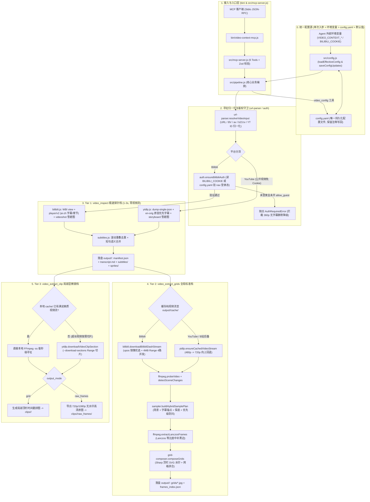

# Video Context MCP 全局架构流程与 Code Review 导读总览

本文档包含基于**统一 `config.yaml` + 外部环境变量双向对接 + 单一 `output/` 输出目录**定稿后的全局端到端流程 Mermaid 图、配置映射表及全部 15 个核心源码文件的逐文件注释索引。

---

## 1. 全局端到端架构与配置/数据流图

---

## 2. 统一 `config.yaml` 与外部环境变量映射表

所有可调控设置均集中在项目根目录唯一的 `config.yaml`（模板见 [config.example.yaml](../config.example.yaml)），并支持在任意 Agent 的环境变量设置面板中直接覆盖：

| `config.yaml` 字段路径 | 对应外部环境变量名 | 默认值 | 说明 |
| :--- | :--- | :---: | :--- |
| `output.dir` | `VIDEO_CONTEXT_OUTPUT_DIR` | `"./output"` | 产物与缓存统一输出根目录 |
| `auth.bilibili_cookie` | `BILIBILI_COOKIE` | `""` | B 站登录 Cookie 字符串（获取 `ai-zh` 字幕与 >=480p 流） |
| `auth.allow_guest_degraded` | `VIDEO_CONTEXT_ALLOW_GUEST` | `false` | 未登录时是否允许降级为 360p 无字幕游客模式 |
| `sampling.scene_threshold` | `VIDEO_CONTEXT_SCENE_THRESHOLD` | `0.25` | Tier 2 视觉场景切换阈值 |
| `sampling.min_interval_sec` | `VIDEO_CONTEXT_MIN_INTERVAL_SEC` | `1.0` | Tier 2 最小防抖间隔（秒） |
| `sampling.max_interval_sec` | `VIDEO_CONTEXT_MAX_INTERVAL_SEC` | `8.0` | Tier 2 最大静默保底间隔（秒） |
| `sampling.max_frames` | `VIDEO_CONTEXT_MAX_FRAMES` | `180` | Tier 2 全片最大抽帧上限 |
| `sampling.clip_interval_sec` | `VIDEO_CONTEXT_CLIP_INTERVAL_SEC` | `0.5` | Tier 3 局部显微镜默认间隔（秒） |
| `sampling.clip_max_span_sec` | `VIDEO_CONTEXT_CLIP_MAX_SPAN_SEC` | `180` | Tier 3 单次最大跨度（秒） |
| `grid.cols` / `grid.rows` | `VIDEO_CONTEXT_GRID_COLS` / `VIDEO_CONTEXT_GRID_ROWS` | `3` / `3` | 拼图列数与行数 |
| `grid.cell_width` / `grid.cell_height` | `VIDEO_CONTEXT_CELL_WIDTH` / `VIDEO_CONTEXT_CELL_HEIGHT` | `640` / `360` | 单格内容宽高（px） |
| `grid.header_height` | `VIDEO_CONTEXT_HEADER_HEIGHT` | `24` | 顶部零遮挡黑边高度（px） |
| `grid.gutter` / `grid.jpeg_quality` | `VIDEO_CONTEXT_GRID_GUTTER` / `VIDEO_CONTEXT_JPEG_QUALITY` | `2` / `85` | 分隔线宽度（px）与 JPEG 质量 |
| `binaries.yt_dlp` / `ffmpeg` / `ffprobe` | `YTDLP_PATH` / `FFMPEG_PATH` / `FFPROBE_PATH` | `""` | 外部二进制路径覆盖 |

---

## 3. 全量已实现模块与注释文档索引表（15 个核心文件）

| 层级 | 已实现源码文件 | 行数 | 对应代码注释导读文档 | 核心审查点摘要 |
| :--- | :--- | :---: | :--- | :--- |
| **入口层** | [bin/video-context-mcp.js](../bin/video-context-mcp.js) | 20 | [docs/bin/video-context-mcp.md](./bin/video-context-mcp.md) | `--output-dir` 启动参数注入、纯净 `stdout` 保护 |
| **配置层** | [src/config.js](../src/config.js) | 293 | [docs/src/config.md](./src/config.md) | 单一 `config.yaml` 读写（保留注释 AST 更新）+ 19 项环境变量双向映射 |
| **协议层** | [src/mcp-server.js](../src/mcp-server.js) | 346 | [docs/src/mcp-server.md](./src/mcp-server.md) | 6 个 MCP 工具（含统一配置读写工具 `video_config`）与 Zod 校验 |
| **编排层** | [src/pipeline.js](../src/pipeline.js) | 797 | [docs/src/pipeline.md](./src/pipeline.md) | 动态配置继承、Cookie 脱敏、Tier 1/2/3 编排、`output/` 规整落盘 |
| **工具层** | [src/utils/exec.js](../src/utils/exec.js) | 82 | [docs/src/utils/exec.md](./src/utils/exec.md) | 数组参数 `spawn` 防 Shell 注入、`SIGKILL` 超时控制、有界并发池 |
| **工具层** | [src/utils/http.js](../src/utils/http.js) | 232 | [docs/src/utils/http.md](./src/utils/http.md) | 裸请求头与 `#HttpOnly_` 解析、临时 Netscape 生成、流式写盘防卡死 |
| **工具层** | [src/utils/time.js](../src/utils/time.js) | 118 | [docs/src/utils/time.md](./src/utils/time.md) | 多格式时间输入解析、防 `:60.0` 进位 Bug、跨平台安全文件名 |
| **解析层** | [src/parsers/url-parser.js](../src/parsers/url-parser.js) | 195 | [docs/src/parsers/url-parser.md](./src/parsers/url-parser.md) | 双平台 URL/BV/av/`b23.tv`/Shorts 归一化、模糊标题拦截 |
| **解析层** | [src/parsers/subtitles.js](../src/parsers/subtitles.js) | 277 | [docs/src/parsers/subtitles.md](./src/parsers/subtitles.md) | BCC/`json3`/VTT 解析、滚动字幕后缀-前缀重叠去重、短句合并 |
| **平台层** | [src/platforms/auth.js](../src/platforms/auth.js) | 149 | [docs/src/platforms/auth.md](./src/platforms/auth.md) | 专注 B 站 `nav` 登录态校验 + WBI 提取 |
| **平台层** | [src/platforms/bilibili.js](../src/platforms/bilibili.js) | 479 | [docs/src/platforms/bilibili.md](./src/platforms/bilibili.md) | WBI 签名、`buvid3` 自举防 `-412`、`upos` 镜像优选、`4MB` Range 并发拉流 |
| **平台层** | [src/platforms/ytdlp.js](../src/platforms/ytdlp.js) | 421 | [docs/src/platforms/ytdlp.md](./src/platforms/ytdlp.md) | YouTube `*-orig` 原音轨优先防 429、横竖屏 480p→720p 选择器、区间切片 |
| **媒体层** | [src/media/sampler.js](../src/media/sampler.js) | 186 | [docs/src/media/sampler.md](./src/media/sampler.md) | 场景+字幕+保底多信号融合、`scene > subtitle` 优先级替换防抖 |
| **媒体层** | [src/media/ffmpeg.js](../src/media/ffmpeg.js) | 202 | [docs/src/media/ffmpeg.md](./src/media/ffmpeg.md) | `-fps_mode vfr` 场景检测、Lanczos 超采样补黑边、片尾 EOF 回退重试 |
| **媒体层** | [src/media/grid-composer.js](../src/media/grid-composer.js) | 168 | [docs/src/media/grid-composer.md](./src/media/grid-composer.md) | `sharp` 零遮挡 SVG 顶栏渲染、动态网格拼合与二维时间矩阵生成 |
