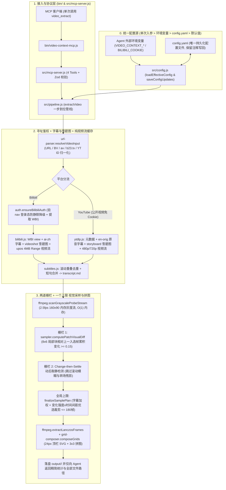

# Video Context MCP 全局架构流程与 Code Review 导读总览

本文档包含升级为**一步到位「两道栅栏 + 一个上限」管线 + 仅回传文件路径 + 统一 `config.yaml` 与环境变量双向映射**后的全局端到端流程 Mermaid 图及全部 15 个核心源码文件的逐文件注释索引。

---

## 1. 全局端到端架构与数据流图

---

## 2. 全量核心源码与注释文档索引表（15 个文件）

| 层级 | 已实现源码文件 | 行数 | 对应代码注释导读文档 | 核心审查点摘要 |
| :--- | :--- | :---: | :--- | :--- |
| **入口层** | [bin/video-context-mcp.js](../bin/video-context-mcp.js) | 20 | [docs/bin/video-context-mcp.md](./bin/video-context-mcp.md) | `--output-dir` 启动参数注入、纯净 `stdout` 保护 |
| **配置层** | [src/config.js](../src/config.js) | 294 | [docs/src/config.md](./src/config.md) | 单一 `config.yaml` 读写 + 19 项环境变量双向映射 |
| **协议层** | [src/mcp-server.js](../src/mcp-server.js) | 251 | [docs/src/mcp-server.md](./src/mcp-server.md) | 精简为 4 个工具（核心一步提取 `video_extract` + 状态/配置/读图） |
| **编排层** | [src/pipeline.js](../src/pipeline.js) | 561 | [docs/src/pipeline.md](./src/pipeline.md) | 一步串联字幕、雪碧图、两道栅栏+上限拼图，仅回传文件路径省 Token |
| **工具层** | [src/utils/exec.js](../src/utils/exec.js) | 82 | [docs/src/utils/exec.md](./src/utils/exec.md) | 数组参数 `spawn` 防 Shell 注入、`SIGKILL` 超时控制、有界并发池 |
| **工具层** | [src/utils/http.js](../src/utils/http.js) | 232 | [docs/src/utils/http.md](./src/utils/http.md) | 裸请求头与 `#HttpOnly_` 解析、临时 Netscape 生成、流式写盘防卡死 |
| **工具层** | [src/utils/time.js](../src/utils/time.js) | 118 | [docs/src/utils/time.md](./src/utils/time.md) | 多格式时间输入解析、防 `:60.0` 进位 Bug、跨平台安全文件名 |
| **解析层** | [src/parsers/url-parser.js](../src/parsers/url-parser.js) | 195 | [docs/src/parsers/url-parser.md](./src/parsers/url-parser.md) | 双平台 URL/BV/av/`b23.tv`/Shorts 归一化、模糊标题拦截 |
| **解析层** | [src/parsers/subtitles.js](../src/parsers/subtitles.js) | 277 | [docs/src/parsers/subtitles.md](./src/parsers/subtitles.md) | BCC/`json3`/VTT 解析、滚动字幕后缀-前缀重叠去重、短句合并 |
| **平台层** | [src/platforms/auth.js](../src/platforms/auth.js) | 149 | [docs/src/platforms/auth.md](./src/platforms/auth.md) | B 站 `nav` 登录态实时核验（防静默降级）+ WBI 提取 |
| **平台层** | [src/platforms/bilibili.js](../src/platforms/bilibili.js) | 475 | [docs/src/platforms/bilibili.md](./src/platforms/bilibili.md) | WBI 签名、`buvid3` 自举防 `-412`、`videoshot` 雪碧图、`4MB` Range 拉流 |
| **平台层** | [src/platforms/ytdlp.js](../src/platforms/ytdlp.js) | 341 | [docs/src/platforms/ytdlp.md](./src/platforms/ytdlp.md) | YouTube `*-orig` 原音轨优先、`storyboard` 雪碧图、横竖屏 480p→720p 流缓存 |
| **媒体层** | [src/media/sampler.js](../src/media/sampler.js) | 255 | [docs/src/media/sampler.md](./src/media/sampler.md) | `8×6` 局部块累积差（栅栏1）+ 动后取静（栅栏2）+ 重要性×间距上限裁剪 |
| **媒体层** | [src/media/ffmpeg.js](../src/media/ffmpeg.js) | 187 | [docs/src/media/ffmpeg.md](./src/media/ffmpeg.md) | `O(1)` 内存灰度裸流管道扫描、Lanczos 超采样居中补黑边抽帧 |
| **媒体层** | [src/media/grid-composer.js](../src/media/grid-composer.js) | 168 | [docs/src/media/grid-composer.md](./src/media/grid-composer.md) | `sharp` 零遮挡 SVG 顶栏渲染、`3×3` 网格拼合与二维时间矩阵生成 |
